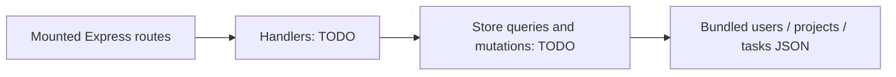

# Project-tracking API exercise

A small Express/TypeScript assessment about joining users, projects and tasks from JSON fixtures. The app mounts routers and parses JSON, but authentication, store access and route behavior remain TODOs. This is an unfinished exercise, not a working project-management backend.

## Start by measuring the baseline

Use Node 22:

```sh
npm ci --ignore-scripts
npm run typecheck
npm test
```

Type checking passes. All **21 acceptance tests currently fail** because the required implementation is absent. The provided source, tests and JSON fixtures are preserved in this presentation pass. `npm run dev` can start the scaffold, but its routes do not satisfy the target API.

## Work through the data flow



Implement `src/db/store.ts`, then the API-key/error middleware and project/user handlers. Preserve exported signatures and the supplied tests. The intended route set is:

| Endpoint | Target behavior |
| --- | --- |
| `GET /projects` | List, optionally filter by owner |
| `GET /projects/:id` | Include that project's tasks |
| `POST /projects` | Validate and create in-memory project |
| `GET /users/:id/summary` | User, owned projects and task counts |

[API_EXERCISE.md](API_EXERCISE.md) retains the target request/response examples. The fixed `x-api-key` value in the exercise is a test fixture, not production security. The removed solutions command/config pointed to a directory that is not present; no working reference solution is included.

## What this can demonstrate after implementation

Typed relationships, data aggregation, request validation and consistent HTTP errors are the useful learning goals. The planned state is in memory after JSON loading; it has no durable writes, database transactions, user-specific authorization or concurrency guarantees. The current reset helper shallow-copies arrays, so future mutation of fixture objects also needs care.

A completed implementation and passing tests would make this a useful practice example. It is not a strong portfolio pin beside completed full-stack projects. No UI screenshots, production-readiness claim or fabricated successful API response is supplied.
